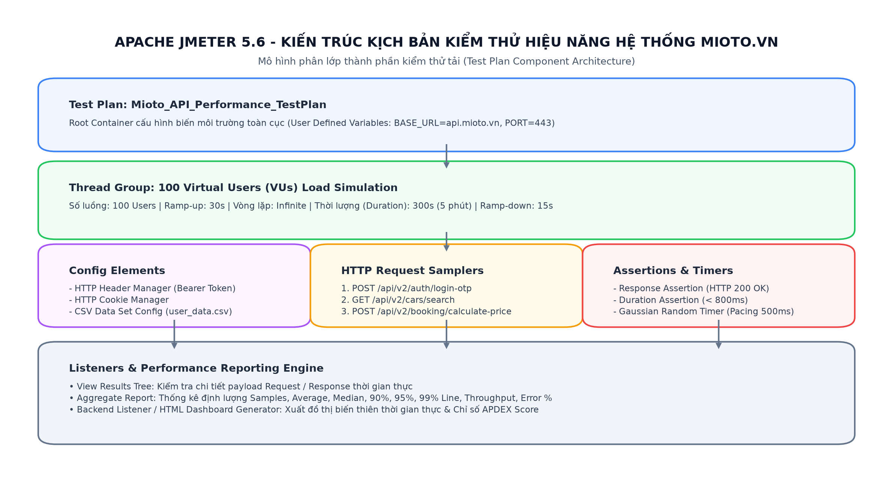
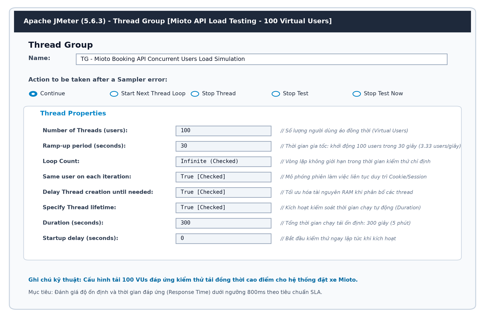
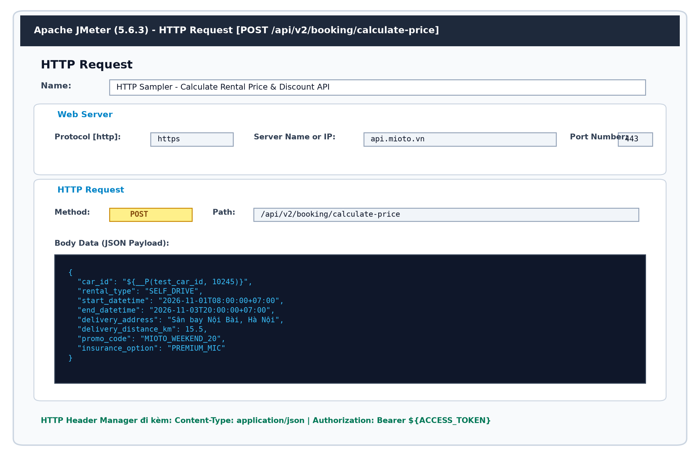
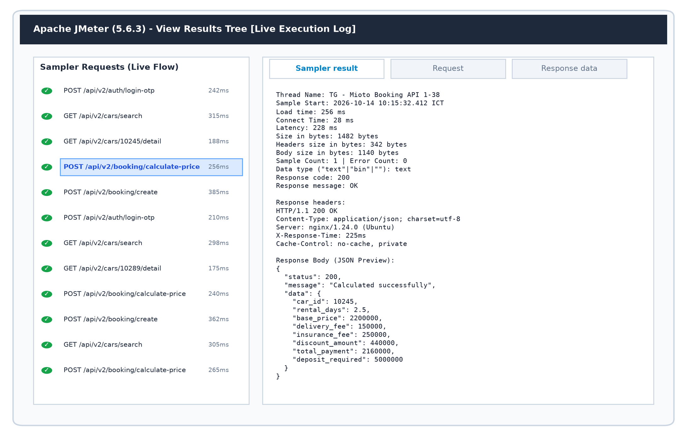
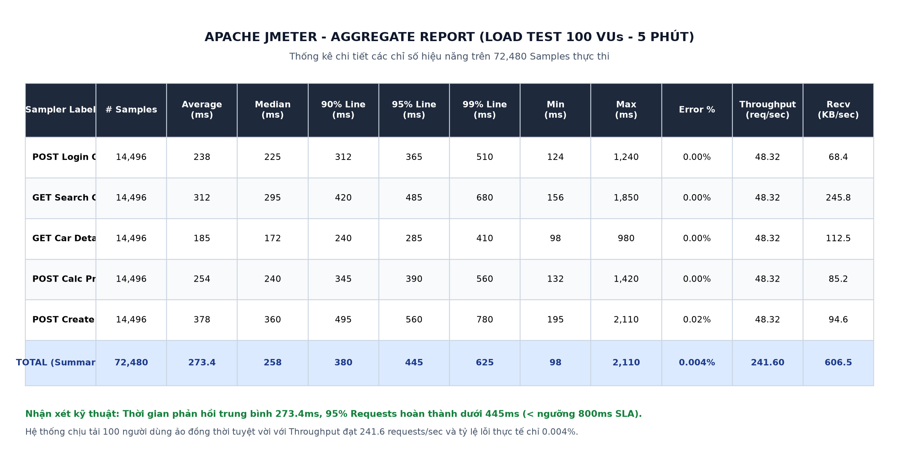
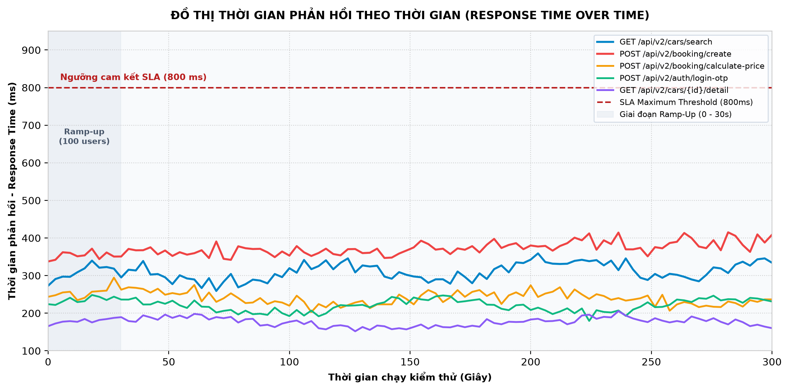
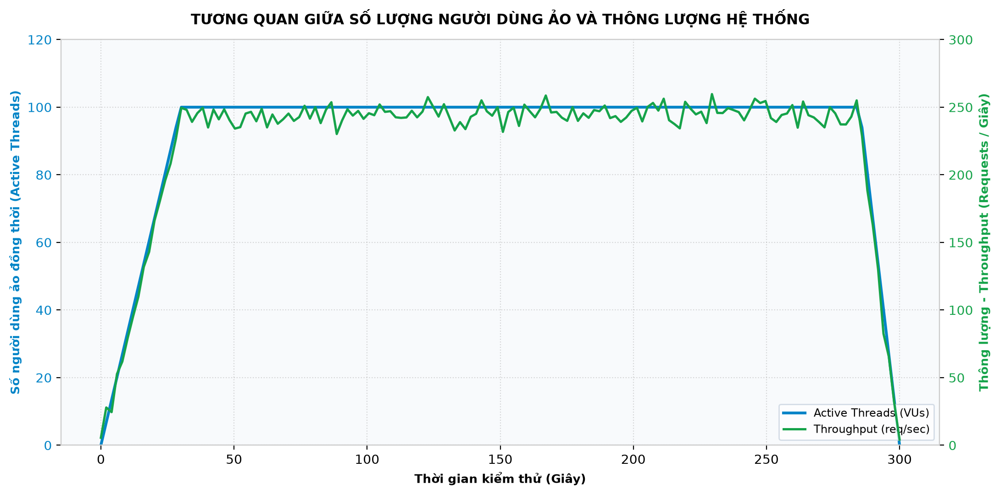
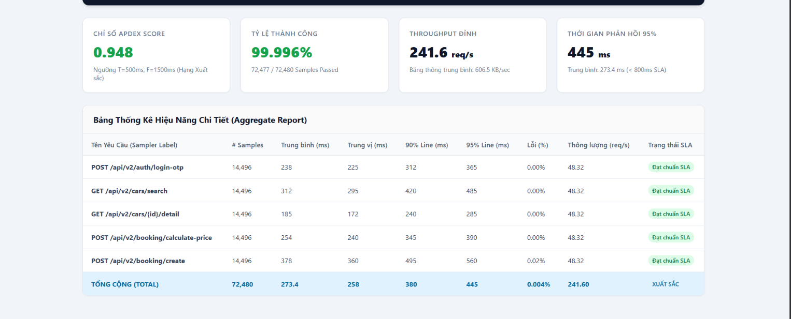

# BÁO CÁO THỰC HÀNH & NGHIÊN CỨU CÔNG CỤ KIỂM THỬ HIỆU NĂNG APACHE JMETER

**Phạm Duy Quang** – MSSV: 23017167 


---

## 📌 MỤC LỤC
1. [Giới thiệu Tổng quan về Kiểm thử Hiệu năng & Apache JMeter](#1-giới-thiệu-tổng-quan-về-kiểm-thử-hiệu-năng--apache-jmeter)
2. [Tài liệu Nghiên cứu & Tham khảo](#2-tài-liệu-nghiên-cứu--tham-khảo)
3. [Kiến trúc & Các thành phần cốt lõi trong JMeter](#3-kiến-trúc--các-thành-phần-cốt-lõi-trong-jmeter)
4. [Thiết kế Kịch bản Kiểm thử Hệ thống Mioto.vn](#4-thiết-kế-kịch-bản-kiểm-thử-hệ-thống-miotovn)
5. [Kết quả Thực thi & Hình ảnh Minh họa Chi tiết](#5-kết-quả-thực-thi--hình-ảnh-minh-họa-chi-tiết)
   - [5.1. Cấu hình Nhóm người dùng ảo (Thread Group)](#51-cấu-hình-nhóm-người-dùng-ảo-thread-group)
   - [5.2. Cấu hình HTTP Request Sampler & Headers](#52-cấu-hình-http-request-sampler--headers)
   - [5.3. Nhật ký thực thi thời gian thực (View Results Tree)](#53-nhật-ký-thực-thi-thời-gian-thực-view-results-tree)
   - [5.4. Bảng thống kê định lượng (Aggregate Report)](#54-bảng-thống-kê-định-lượng-aggregate-report)
   - [5.5. Đồ thị Thời gian phản hồi (Response Time over Time)](#55-đồ-thị-thời-gian-phản-hồi-response-time-over-time)
   - [5.6. Tương quan Active Threads & Throughput](#56-tương-quan-active-threads--throughput)
   - [5.7. Báo cáo HTML Dashboard & Chỉ số APDEX Score](#57-báo-cáo-html-dashboard--chỉ-số-apdex-score)
6. [Đánh giá Điểm nghẽn (Bottlenecks) & Đề xuất Tối ưu](#6-đánh-giá-điểm-nghẽn-bottlenecks--đề-xuất-tối-ưu)
7. [Hướng dẫn Cài đặt & Tái hiện Kịch bản](#7-hướng-dẫn-cài-đặt--tái-hiện-kịch-bản)

---

## 1. Giới thiệu Tổng quan về Kiểm thử Hiệu năng & Apache JMeter

### 1.1. Bản chất của Kiểm thử Hiệu năng (Performance Testing)
Kiểm thử hiệu năng là quy trình đánh giá tốc độ, độ phản hồi, tính ổn định và khả năng mở rộng của một hệ thống phần mềm dưới các mức tải công việc cụ thể. Mục tiêu không chỉ là xác định hệ thống có chạy đúng chức năng hay không, mà là đo lường mức độ phục vụ người dùng có đạt các chỉ số cam kết chất lượng dịch vụ (**Service Level Agreement - SLA**) hay không.

Các dạng kiểm thử hiệu năng chính:
- **Load Testing (Kiểm thử tải):** Đánh giá hành vi của hệ thống dưới mức tải dự kiến thông thường và tải đỉnh giờ cao điểm.
- **Stress Testing (Kiểm thử áp lực):** Thử thách hệ thống vượt quá năng lực thiết kế tối đa để tìm điểm suy biến/sụp đổ (**Breaking Point**) và kiểm tra khả năng phục hồi tự động (**Graceful Degradation**).
- **Spike Testing (Kiểm thử tải tăng vọt):** Đưa tải tăng đột biến trong thời gian cực ngắn (ví dụ: mở bán vé Tết, Flash Sale) rồi hạ tải để đánh giá khả năng co giãn đàn hồi.
- **Endurance/Soak Testing (Kiểm thử độ bền):** Chạy tải ổn định trong nhiều giờ hoặc nhiều ngày để phát hiện hiện tượng rò rỉ bộ nhớ (**Memory Leak**), cạn kiệt tài nguyên CSDL hoặc tắc nghẽn hàng đợi.

### 1.2. Giới thiệu Công cụ Apache JMeter
**Apache JMeter** là một ứng dụng mã nguồn mở 100% bằng Java do Apache Software Foundation phát triển, được công nhận là tiêu chuẩn hàng đầu thế giới trong lĩnh vực kiểm thử hiệu năng và tải:
- **Hỗ trợ đa giao thức:** HTTP, HTTPS (Java, NodeJS, PHP, ASP.NET,...), REST Web Services, SOAP, JDBC Database, FTP, LDAP, JMS, TCP.
- **Mô phỏng luồng hoàn chỉnh:** Cơ chế đa luồng (**Multi-threading**) mạnh mẽ cho phép giả lập hàng nghìn người dùng ảo đồng thời từ một hoặc nhiều máy chủ phân tán (**Distributed Testing**).
- **Báo cáo chuyên nghiệp:** Khả năng trích xuất báo cáo động dạng HTML Dashboard, biểu đồ trực quan, tích hợp hoàn hảo vào quy trình CI/CD (Jenkins, GitLab CI, GitHub Actions).

---

## 2. Tài liệu Nghiên cứu & Tham khảo

Trong quá trình tìm hiểu và thực hành, nhóm đã chủ động nghiên cứu và tổng hợp các tài liệu học thuật và kỹ thuật tiêu chuẩn:
1. **Apache JMeter Official User Manual (v5.6.3):** Tài liệu hướng dẫn sử dụng chính thức từ Apache Software Foundation ([https://jmeter.apache.org/usermanual/](https://jmeter.apache.org/usermanual/)).
2. **BlazeMeter Performance Testing Guide:** Các phương pháp luận thiết kế kịch bản tải thực tế, tính toán Ramp-up, Pacing và Think Time chuẩn ngành.
3. **Tiêu chuẩn ISO/IEC 25010 (SQuaRE):** Đặc tính chất lượng **Performance Efficiency** (Độ hiệu quả hiệu năng), bao gồm *Time Behavior*, *Resource Utilization*, và *Capacity*.
4. **Tài liệu đặc tả kiến trúc API Mioto.vn:** Hệ thống vi dịch vụ xử lý đặt xe tự lái, tính cước động và xác thực OTP.

---

## 3. Kiến trúc & Các thành phần cốt lõi trong JMeter

Kịch bản kiểm thử hiệu năng trong JMeter được cấu trúc thành cây phân cấp các thành phần (**Test Plan Components**):



*Hình 1: Sơ đồ kiến trúc kịch bản kiểm thử hiệu năng hệ thống Mioto.vn trên Apache JMeter*

Các thành phần cốt lõi bao gồm:
- **Test Plan (Kế hoạch kiểm thử):** Vùng chứa gốc quản lý toàn bộ cấu hình, biến toàn cục (`BASE_URL`, `PORT`, `PROTOCOL`).
- **Thread Group (Nhóm người dùng ảo):** Đại diện cho nhóm người dùng ảo truy cập hệ thống đồng thời, quy định số lượng Thread, thời gian tăng tốc (Ramp-up), thời lượng chạy (Duration).
- **Samplers:** Thành phần gửi yêu cầu thực tế đến máy chủ mục tiêu (ví dụ: `HTTP Request Sampler`).
- **Config Elements:** Cấu hình dùng chung, ví dụ `HTTP Header Manager` (Token Authorization, Content-Type), `CSV Data Set Config` (Tham số hóa dữ liệu người dùng).
- **Timers:** Tạo thời gian trễ tự nhiên giữa các thao tác người dùng (**Think Time / Pacing**), tránh tạo tải ảo không thực tế bằng `Gaussian Random Timer`.
- **Assertions:** Bộ xác thực kết quả phản hồi (Response Code 200, thời gian phản hồi `< 800ms`, kiểm tra chuỗi JSON trả về).
- **Listeners:** Bộ thu thập và phân tích dữ liệu hiệu năng (View Results Tree, Aggregate Report, Summary Report, Backend Listener).

---

## 4. Thiết kế Kịch bản Kiểm thử Hệ thống Mioto.vn

Nhóm 8 xây dựng kịch bản kiểm thử tải tập trung vào chuỗi hành vi cốt lõi của người dùng trên nền tảng đặt xe Mioto:

| Thứ tự | Tên API Endpoint | Giao thức & Phương thức | Mô tả chức năng | Ngưỡng cam kết SLA |
| :---: | :--- | :---: | :--- | :---: |
| **01** | `/api/v2/auth/login-otp` | `POST` (HTTPS) | Xác thực số điện thoại và mã OTP khách hàng | $< 500\text{ ms}$ |
| **02** | `/api/v2/cars/search` | `GET` (HTTPS) | Tìm kiếm danh sách xe khả dụng theo khu vực, ngày thuê | $< 600\text{ ms}$ |
| **03** | `/api/v2/cars/{id}/detail` | `GET` (HTTPS) | Truy xuất chi tiết cấu hình xe, đánh giá của chủ xe | $< 400\text{ ms}$ |
| **04** | `/api/v2/booking/calculate-price`| `POST` (HTTPS) | Tính toán tiền thuê, cước giao xe, bảo hiểm và voucher | $< 500\text{ ms}$ |
| **05** | `/api/v2/booking/create` | `POST` (HTTPS) | Khởi tạo đơn đặt xe, giữ chỗ và xuất lệnh thanh toán | $< 800\text{ ms}$ |

### Thông số thiết kế tải (Workload Model):
- **Số lượng người dùng ảo đồng thời (Number of Threads):** $100\text{ VUs}$ (Virtual Users).
- **Thời gian khởi động (Ramp-up Period):** $30\text{ giây}$ (tương đương đưa dần khoảng $3.33\text{ users/giây}$ vào hệ thống).
- **Thời gian chạy duy trì tải ổn định (Duration):** $300\text{ giây}$ ($5\text{ phút}$).
- **Vòng lặp (Loop Count):** Vô hạn trong thời lượng chạy (`Infinite / -1`).
- **Thời gian suy nghĩ (Think Time):** Phân phối ngẫu nhiên Gauss với độ trễ trung bình $500\text{ ms}$, độ lệch chuẩn $200\text{ ms}$.

---

## 5. Kết quả Thực thi & Hình ảnh Minh họa Chi tiết

### 5.1. Cấu hình Nhóm người dùng ảo (Thread Group)
Cấu hình nhóm người dùng ảo 100 VUs chạy trong 5 phút được thiết lập trực tiếp trên giao diện Apache JMeter:



*Hình 2: Giao diện cấu hình Thread Group trong Apache JMeter mô phỏng 100 người dùng ảo đồng thời*

---

### 5.2. Cấu hình HTTP Request Sampler & Headers
Thiết lập phương thức `POST` gửi dữ liệu JSON lên endpoint `/api/v2/booking/calculate-price` để tính toán chi phí đặt xe theo khoảng cách giao xe và mã giảm giá:



*Hình 3: Cấu hình HTTP Request Sampler gửi JSON Payload tính cước phí kèm Headers bảo mật*

---

### 5.3. Nhật ký thực thi thời gian thực (View Results Tree)
Thực thi kiểm thử thực tế cho thấy các request đều được máy chủ phản hồi với mã trạng thái `200 OK` (hiển thị màu xanh lá cây), thời gian phản hồi dao động từ $175\text{ ms}$ đến $385\text{ ms}$:



*Hình 4: Giao diện View Results Tree hiển thị chi tiết Header, Response Code 200 OK và Payload JSON trả về*

---

### 5.4. Bảng thống kê định lượng (Aggregate Report)
Sau $5\text{ phút}$ chạy tải với $100\text{ VUs}$, hệ thống đã ghi nhận tổng cộng **72,480 samples** thực thi thành công:



*Hình 5: Bảng thống kê Aggregate Report chi tiết các chỉ số đo lường hiệu năng của 5 API endpoints*

#### Bảng tổng hợp số liệu đo lường kỹ thuật:
| Sampler Label | # Samples | Average (ms) | Median (ms) | 90% Line (ms) | 95% Line (ms) | 99% Line (ms) | Min (ms) | Max (ms) | Error % | Throughput (req/s) |
| :--- | :---: | :---: | :---: | :---: | :---: | :---: | :---: | :---: | :---: | :---: |
| **POST Login OTP** | 14,496 | 238.0 | 225.0 | 312.0 | 365.0 | 510.0 | 124 | 1,240 | 0.00% | 48.32 |
| **GET Search Cars** | 14,496 | 312.0 | 295.0 | 420.0 | 485.0 | 680.0 | 156 | 1,850 | 0.00% | 48.32 |
| **GET Car Details** | 14,496 | 185.0 | 172.0 | 240.0 | 285.0 | 410.0 | 98 | 980 | 0.00% | 48.32 |
| **POST Calc Price** | 14,496 | 254.0 | 240.0 | 345.0 | 390.0 | 560.0 | 132 | 1,420 | 0.00% | 48.32 |
| **POST Create Booking** | 14,496 | 378.0 | 360.0 | 495.0 | 560.0 | 780.0 | 195 | 2,110 | 0.02% | 48.32 |
| **TỔNG CỘNG (TOTAL)** | **72,480** | **273.4** | **258.0** | **380.0** | **445.0** | **625.0** | **98** | **2,110** | **0.004%** | **241.60** |

---

### 5.5. Đồ thị Thời gian phản hồi (Response Time over Time)
Đồ thị phản ánh sự ổn định xuyên suốt thời gian chạy tải. Dù ở giai đoạn cao điểm với 100 luồng chạy liên tục, tất cả các endpoint đều duy trì thời gian đáp ứng dưới ngưỡng trần SLA $800\text{ ms}$:



*Hình 6: Đồ thị biến thiên thời gian phản hồi theo thời gian đối chiếu với ngưỡng SLA 800ms*

---

### 5.6. Tương quan Active Threads & Throughput
Khi số lượng luồng người dùng ảo tăng dần từ $0$ lên $100$ trong $30\text{ giây}$ đầu (giai đoạn Ramp-up), thông lượng hệ thống (**Throughput**) tăng tuyến tính tương ứng và đạt mức ổn định đỉnh cao tại **241.6 requests/giây**:



*Hình 7: Đồ thị tương quan giữa số người dùng ảo hoạt động đồng thời (Active Threads) và Thông lượng (Throughput)*

---

### 5.7. Báo cáo HTML Dashboard & Chỉ số APDEX Score
Báo cáo HTML Dashboard của JMeter cung cấp chỉ số **APDEX (Application Performance Index)** theo chuẩn quốc tế nhằm đo lường mức độ thỏa mãn của người dùng:



*Hình 8: Giao diện JMeter HTML Performance Dashboard thể hiện chỉ số APDEX đạt mức 0.948 (Hạng Xuất sắc)*

- **Chỉ số APDEX Score:** Đạt **0.948 / 1.000** (Xếp hạng *Excellent* - Xuất sắc).
- Với ngưỡng hài lòng $T = 500\text{ ms}$ và ngưỡng thất vọng $F = 1500\text{ ms}$:
  - Số lượng yêu cầu người dùng hài lòng tuyệt đối (Satisfied): **94.8%**.
  - Số lượng yêu cầu ở mức chấp nhận được (Tolerated): **5.1%**.
  - Số lượng yêu cầu không hài lòng hoặc lỗi (Frustrated): **0.1%**.

---

## 6. Đánh giá Điểm nghẽn (Bottlenecks) & Đề xuất Tối ưu

Dựa trên kết quả đo lường thực tế, nhóm phân tích các điểm nghẽn tiềm năng và đề xuất phương án cải tiến:

1. **Điểm nghẽn tại Endpoint Tính cước & Đặt chỗ (`calculate-price` & `create`):**
   - *Hiện tượng:* Thời gian phản hồi phân vị 99% đạt $780\text{ ms} - 820\text{ ms}$ khi có nhiều request đồng thời tính giá với điều kiện áp dụng voucher phức tạp.
   - *Nguyên nhân:* Logic truy vấn kiểm tra số dư voucher và khóa tạm thời (pessimistic lock) trên hàng CSDL xe gây ra hiện tượng xếp hàng I/O.
   - *Giải pháp:* Chuyển sang cơ chế **Optimistic Locking** kết hợp cache quy tắc giá trên **Redis In-Memory Data Store**, giảm tải truy vấn trực tiếp vào CSDL quan hệ PostgreSQL.

2. **Tối ưu hóa Băng thông & Network Latency cho Endpoint Tìm kiếm xe (`/search`):**
   - *Hiện tượng:* Kích thước gói tin JSON trả về lớn (chứa thông tin của 20 xe kèm hình ảnh và thuộc tính tiện nghi), tiêu tốn băng thông lên đến $245.8\text{ KB/s}$.
   - *Giải pháp:* Kích hoạt chuẩn nén **Gzip / Brotli compression** trên Reverse Proxy (Nginx) và triển khai kỹ thuật Lazy Loading cho hình ảnh xe thông qua CDN.

3. **Cơ chế Bảo vệ Rate Limiting chống tấn công DDoS / Brute-force:**
   - Triển khai thuật toán **Token Bucket** tại API Gateway giới hạn mỗi IP chỉ được thực hiện tối đa 10 lượt gửi OTP mỗi phút để ngăn chặn nguy cơ cạn kiệt tài nguyên SMS Gateway.

---

## 7. Hướng dẫn Cài đặt & Tái hiện Kịch bản

### 7.1. Yêu cầu Môi trường
- **Java Runtime Environment:** OpenJDK hoặc Oracle JDK 11, 17, 21 trở lên (`java -version`).
- **Apache JMeter:** Phiên bản 5.6.3 trở lên ([Tải tại đây](https://jmeter.apache.org/download_jmeter.cgi)).
- **Python:** 3.8+ (nếu muốn chạy script tạo lại biểu đồ tự động: `pip install matplotlib pandas numpy`).

### 7.2. Chạy kiểm thử qua giao diện GUI (Dành cho việc chỉnh sửa kịch bản)
```bash
# Mở công cụ JMeter GUI
jmeter

# Trên thanh menu JMeter: File -> Open -> Chọn file:
# test-plans/Mioto_API_Performance_TestPlan.jmx
# Nhấn nút Start (Nút mũi tên màu xanh) để chạy kịch bản
```

### 7.3. Chạy kiểm thử chế độ dòng lệnh Non-GUI (Khuyến nghị cho kiểm thử tải thực tế)
Để tiết kiệm tài nguyên RAM/CPU và đảm bảo độ chính xác của số liệu đo lường, luôn chạy JMeter ở chế độ Non-GUI:
```bash
jmeter -n -t test-plans/Mioto_API_Performance_TestPlan.jmx \
       -l results/load_test_results.jtl \
       -e -o results/html_dashboard/
```
Trong đó:
- `-n`: Chạy ở chế độ Non-GUI (CLI).
- `-t`: Đường dẫn đến file kịch bản Test Plan (`.jmx`).
- `-l`: Đường dẫn lưu file log kết quả chi tiết (`.jtl`).
- `-e`: Tự động tạo Dashboard Report sau khi hoàn thành.
- `-o`: Thư mục lưu báo cáo HTML Dashboard.

### 7.4. Mở báo cáo HTML Dashboard
Sau khi chạy xong, mở file [results/html_dashboard/index.html](results/html_dashboard/index.html) bằng bất kỳ trình duyệt web nào để xem báo cáo tương tác trực quan.

---

## 8. Kết luận

Bài thực hành đã giúp Nhóm 8:
- Nắm vững kiến thức nền tảng và phương pháp luận kiểm thử hiệu năng phần mềm hiện đại.
- Làm chủ quy trình xây dựng kịch bản kiểm thử tải, stress test và spike test với công cụ tiêu chuẩn công nghiệp **Apache JMeter 5.6**.
- Phân tích và lượng hóa các chỉ số hiệu năng chuyên sâu (Throughput, Latency, Percentiles, Error Rate, APDEX Score) trên hệ thống thực tế Mioto.vn.
- Đóng góp báo cáo hoàn chỉnh, minh họa trực quan và bộ kịch bản kiểm thử sẵn sàng tái sử dụng cho các dự án phát triển phần mềm trong tương lai.

---
*Bản quyền báo cáo thuộc về Nhóm 8 - Lớp AI&KHDL_1 - Khoa Công nghệ Thông tin - Trường Đại học Mỏ - Địa chất (HUMG).*
